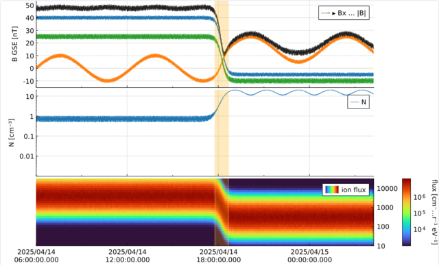
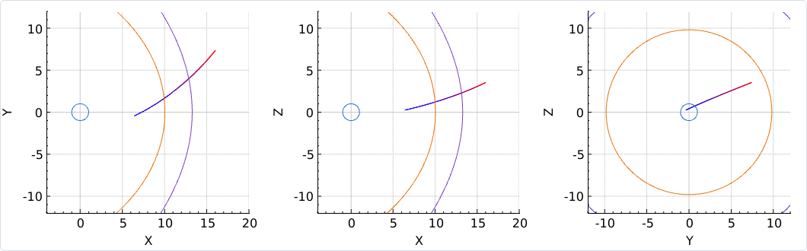

[](https://www.gnu.org/licenses/gpl-3.0)

[](https://pypi.python.org/pypi/sciqlopplots)
[](https://sciqlopplots.readthedocs.io/en/latest/)

# SciQLopPlots

A high-performance scientific plotting library built on C++20/Qt6 with Python bindings via Shiboken6 (PySide6). Designed for the [SciQLop](https://github.com/SciQLop/SciQLop) data analysis platform but usable standalone.

**[Try it in your browser](https://sciqlop.github.io/SciQLopPlots/):** the gallery runs the same library as WebAssembly, with examples you can edit and run. The [JavaScript guide](https://sciqlopplots.readthedocs.io/en/latest/javascript.html) shows how to use it in your own pages.

<p align="center">
  <a href="https://sciqlop.github.io/SciQLopPlots/latest/gallery/spacecraft-crossing.html"></a>
  <br>
  <a href="https://sciqlop.github.io/SciQLopPlots/latest/gallery/mms-bow-shock.html"></a>
</p>

## Features

- **Async resampling** — render millions of points smoothly; data is downsampled in background threads via [NeoQCP](https://github.com/SciQLop/NeoQCP) pipelines
- **Multiple plot types** — time series (line graphs), spectrograms (color maps), 2D histograms, parametric curves, N-D projection curves, waterfall plots
- **Interactive** — pan, zoom, data-driven callbacks, vertical/horizontal/rectangular spans, tracers, straight lines, text, shapes, pixmaps
- **Multi-plot panels** — synchronized axes, aligned margins, drag-and-drop from product trees
- **Interval timelines** — events and instrument modes as bars on named lanes, drawn like a logic analyzer's wave view; overlaps stacked by time or category, or forbidden; editable with the mouse
- **Reactive pipelines** — connect plot properties with `>>` to build live data flows
- **Export** — PDF (vector), PNG, JPG, BMP for both individual plots and panels
- **Busy indicator** — visual feedback when data is loading or being processed
- **Runtime inspector** — tree model/view for inspecting and editing plot properties
- **Signal processing** — gap-aware filters, FFT, spectrograms and rolling statistics on NumPy arrays (`SciQLopPlots.dsp`)
- **In the browser** — the same plots from JavaScript, compiled to WebAssembly ([gallery](https://sciqlop.github.io/SciQLopPlots/), [guide](https://sciqlopplots.readthedocs.io/en/latest/javascript.html))
- **Cross-platform** — Linux, macOS and Windows, on x86-64 and ARM64

## Architecture


### Data flow


## Quick start

The **[user guide](https://sciqlopplots.readthedocs.io/en/latest/user-guide.html)** walks through everything below and more: plot types, live data, time series, panels, overlays, pipelines and export. Every example in it is tested. The **[API reference](https://sciqlopplots.readthedocs.io/en/latest/api.html)** lists every class and method.

```bash
pip install SciQLopPlots
```

Wheels exist for Python 3.12 to 3.14. They pin PySide6 to an exact version, so installing replaces any other PySide6 in the environment.

```python
import numpy as np
from PySide6.QtWidgets import QApplication
from SciQLopPlots import SciQLopPlot

app = QApplication([])
plot = SciQLopPlot()

# Static data and a data function, both on the same plot
x = np.arange(0, 1000, dtype=np.float64)
y = np.sin(x / 100) * np.cos(x / 10)
plot.plot(x, y, labels=["signal"])

# Data callback (called on pan/zoom with visible range)
def get_data(start, stop):
    x = np.arange(start, stop, dtype=np.float64)
    y = np.column_stack([np.sin(x / 100), np.cos(x / 100)])
    return x, y

plot.plot(get_data, labels=["sin", "cos"])

plot.show()
app.exec()
```

### Reactive pipelines

Connect plot properties with the `>>` operator, optionally through a function:

```python
import numpy as np
from PySide6.QtGui import QColor
from SciQLopPlots import SciQLopPlot, SciQLopPlotRange

plot = SciQLopPlot()
x = np.linspace(0, 10, 1000)
plot.plot(x, np.sin(x), labels=["sin"])
span = plot.vertical_span(SciQLopPlotRange(2.0, 4.0), QColor(100, 200, 100, 80),
                          read_only=False, visible=True, tooltip="")

def describe(event):
    return f"{event.value.start():.2f} .. {event.value.stop():.2f}"

span.on.range >> describe >> span.on.tooltip   # the tooltip follows the span

zoomed = SciQLopPlot()
zoomed.plot(x, np.sin(x), labels=["zoom"])
span.on.range >> zoomed.x_axis().on.range      # a second plot shows the span's interval
```

The function gets an event whose `.value` is the new value. The [user guide](https://sciqlopplots.readthedocs.io/en/latest/user-guide.html#reactive-pipelines) lists the properties you can connect.

To see every feature, try the [browser gallery](https://sciqlop.github.io/SciQLopPlots/), or run the desktop gallery from a source checkout:

```bash
python tests/manual-tests/gallery.py
```

## Runtime tracing

A built-in tracer writes Chrome trace JSON, to open in [Perfetto](https://ui.perfetto.dev/),
[Speedscope](https://www.speedscope.app/) or `chrome://tracing`. It is always compiled in and
costs about 1 ns when off. Your own Python zones show next to the library's:

```python
import numpy as np
from SciQLopPlots import tracing

with tracing.session("/tmp/sciqlop.json"):
    with tracing.zone("my.fetch", cat="data"):
        data = np.random.default_rng().normal(size=1_000_000)   # your code here
```

`SCIQLOP_TRACE=/tmp/sciqlop.json python my_script.py` turns it on for a whole run. The
[API reference](https://sciqlopplots.readthedocs.io/en/latest/api.html#tracing) lists the rest:
decorators, counters, and [Tracy](https://github.com/wolfpld/tracy) when built with `tracy_enable=true`.

## Building from source

You need Qt 6.12, a C++20 compiler, libclang (for Shiboken) and, in a virtual environment,
the exact PySide6 version the package pins:

```bash
pip install pyside6==6.12.0 shiboken6==6.12.0 shiboken6-generator==6.12.0 \
    numpy meson meson-python ninja

# Qt's tools must be on PATH
export PATH=/path/to/Qt/6.12.0/gcc_64/bin:$PATH
export PKG_CONFIG_PATH=/path/to/Qt/6.12.0/gcc_64/lib/pkgconfig:$PKG_CONFIG_PATH

# debugoptimized, not debug: without optimisations the resampling is slow
meson setup build --buildtype=debugoptimized
meson compile -C build

# or build and install it as a Python package
pip install . --no-build-isolation
```

Build options: `-Dtracy_enable=true` turns on Tracy profiling, `-Dtrace_refcount=true` traces
Python reference counts, and `-Dwith_opengl=false` builds without OpenGL.
The browser build is described in the [JavaScript guide](https://sciqlopplots.readthedocs.io/en/latest/javascript.html).

## Contributing

Bug reports, feature requests and pull requests are welcome on
[GitHub](https://github.com/SciQLop/SciQLopPlots/issues). A bug fix comes with a test that fails
without it. Run the tests from outside the source tree, so the built package is the one imported:

```bash
cd /tmp && PYTHONPATH=/path/to/SciQLopPlots/build python -m pytest \
    /path/to/SciQLopPlots/tests/{integration,unit,fuzzing,resampler,tracing}
```

## Credits

Development is supported by [CDPP](https://www.cdpp.eu/).
We acknowledge support from [Plas@Par](https://www.plasapar.sorbonne-universite.fr).

## Thanks

- [PySide6](https://doc.qt.io/qtforpython-6/index.html) — Qt bindings and Shiboken6 binding generator
- [NeoQCP](https://github.com/SciQLop/NeoQCP) — our fork of [QCustomPlot](https://www.qcustomplot.com/), which draws on the GPU and plots large data without copying it
