# SciQLopPlots user guide

SciQLopPlots draws scientific plots in Qt applications. It is fast with big data: millions of points pan and zoom smoothly, because a background thread downsamples what you see.

It is a normal Qt widget library. Use it from Python (PySide6) in a script, a notebook-launched window, or your own application.

This guide goes from a first plot to live data, multi-plot panels, overlays and export. Every Python snippet in it is run by the test suite (`tests/integration/test_user_guide.py`), so it matches the installed library.

- [Install](#install)
- [Your first plot](#your-first-plot)
- [Put a plot in your own window](#put-a-plot-in-your-own-window)
- [Plot types](#plot-types)
- [Live data: plot a function](#live-data-plot-a-function)
- [Time series](#time-series)
- [Several plots in a panel](#several-plots-in-a-panel)
- [Axes](#axes)
- [Colours, names and themes](#colours-names-and-themes)
- [Overlays: spans, lines and text](#overlays-spans-lines-and-text)
- [Interval timelines](#interval-timelines)
- [Reactive pipelines](#reactive-pipelines)
- [N-D projections](#n-d-projections)
- [Signal processing](#signal-processing)
- [Export](#export)
- [Performance tips](#performance-tips)
- [Troubleshooting](#troubleshooting)

## Install

```bash
pip install SciQLopPlots
```

This pulls in NumPy and PySide6. PySide6 is pinned to an exact version, so installing replaces any other PySide6 in the environment.
Wheels exist for Python 3.11 to 3.14, on Linux, macOS and Windows, x86-64 and ARM64.
To plot in a web page instead, see [JavaScript (WebAssembly)](javascript.md).

## Your first plot

```python
import sys
import numpy as np
from PySide6.QtWidgets import QApplication
from SciQLopPlots import SciQLopPlot

app = QApplication(sys.argv)

x = np.linspace(0, 10, 1000)
plot = SciQLopPlot()
plot.plot(x, np.sin(x), labels=["sin"])
plot.show()

app.exec()
```

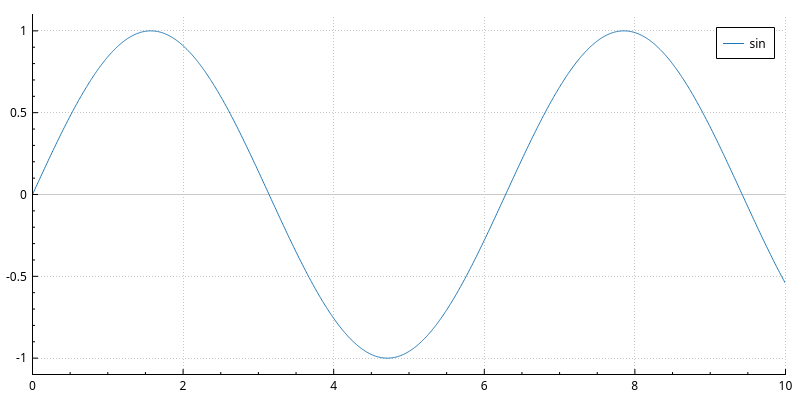

Three things to know:

1. **A `QApplication` must exist first.** Create it once, before any plot. Qt needs it for every widget.
2. **`plot()` returns a graph object.** Keep it if you want to change the data or style later.
3. **`app.exec()` runs the window** until you close it. In an application you already have, skip it.

Mouse controls:

| Action | Effect |
|---|---|
| Drag | pan |
| Wheel | scroll along x |
| Ctrl + wheel | zoom x |
| Shift + wheel | zoom y |
| Ctrl + Shift + wheel | scroll along y |
| Wheel over an axis | zoom that axis only |
| Wheel over the colour scale | zoom the colour range |

## Put a plot in your own window

A plot is a `QWidget`. Put it in any layout, like a button or a label.

```python
import sys
import numpy as np
from PySide6.QtWidgets import QApplication, QMainWindow, QWidget, QVBoxLayout, QPushButton
from SciQLopPlots import SciQLopPlot

app = QApplication(sys.argv)

window = QMainWindow()
central = QWidget()
layout = QVBoxLayout(central)

plot = SciQLopPlot()
x = np.linspace(0, 10, 1000)
graph = plot.plot(x, np.sin(x), labels=["signal"])

button = QPushButton("Cosine")
button.clicked.connect(lambda: graph.set_data(x, np.cos(x)))

layout.addWidget(plot)
layout.addWidget(button)
window.setCentralWidget(central)
window.resize(800, 500)
window.show()

app.exec()
```

`graph.set_data(x, y)` replaces the data at any time. The plot redraws by itself.

## Plot types

`plot.plot(*args, graph_type=None, **kwargs)` picks the graph type from its arguments. Pass `graph_type=` to choose another one.

The kind comes from the shape of the arguments, then from `graph_type`:

- Two arrays make a line by default. `graph_type` turns them into a scatter, a parametric curve, a waterfall or a 2-D histogram.
- Three arrays make a colour map.
- One array with `graph_type=GraphType.Histogram` makes a histogram.
- A list of arrays `[t, d0, d1, ...]` makes a projection, on a panel or a projection plot only: a single plot raises `NotImplementedError`. `t, d0, d1, d2` (four arrays) and `t, values` (one column per dimension) do the same, but only with `plot_type=PlotType.Projections` on a panel or `graph_type=GraphType.ParametricCurve` on a projection plot.
- A function makes a line by default. `graph_type` picks another kind.

An unknown keyword raises `TypeError` and names the kind that owns the keywords. On a single plot, `plot_type` raises `TypeError`: it only means something on a panel, where it picks the kind of plot to create.

| You pass | You get | `graph_type` |
|---|---|---|
| `x, y` with `y` of shape `(n,)` or `(n, k)` | line graph, `k` lines | `GraphType.Line` (default) |
| `x, y` | markers only | `GraphType.Scatter` |
| `x, y, z` | colour map (spectrogram) | `GraphType.ColorMap` (implied) |
| `x, y` where `x` is not sorted (orbits, hodograms) | parametric curve | `GraphType.ParametricCurve` |
| `x, y` with `y` of shape `(n, k)` | `k` stacked traces | `GraphType.Waterfall` |
| `x, y` scatter points | 2-D density histogram | `GraphType.Histogram2D` |

`x` must be `float64`. Values (`y`, `z`) can be any numeric dtype: `float32`, integers, etc. They are read in place, without a copy.

### Lines

```python
import numpy as np
from PySide6.QtGui import QColorConstants
from SciQLopPlots import SciQLopPlot

plot = SciQLopPlot()
x = np.linspace(0, 10, 100_000)
y = np.column_stack([np.sin(x), np.cos(x), np.sin(2 * x)])  # 3 lines
graph = plot.plot(x, y, labels=["sin", "cos", "sin 2x"],
                  colors=[QColorConstants.Red, QColorConstants.Blue, QColorConstants.DarkGreen])
```

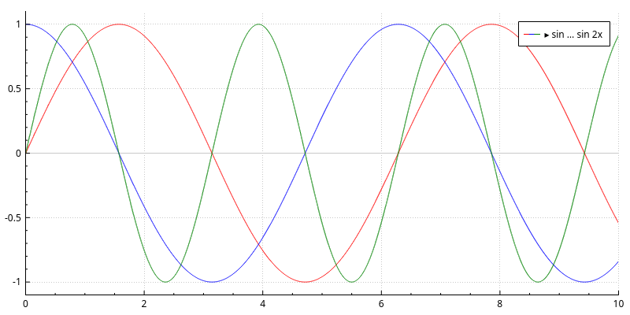

A 2-D `y` gives one line per column. `labels` names them in the legend, and `colors` sets their colours. Both are optional.

A step in `x` much longer than its neighbours is drawn as a data gap: the line breaks there. `graph.set_gap_threshold(f)` sets how much longer (default 1.5 times); `0` never breaks the line, for keys that are uneven on purpose. A NaN value always breaks it.

### Bands, fills and error bars

`plot.band(x, lower, upper)` shades the area between two curves. It draws no line of its own.

```python
import numpy as np
from SciQLopPlots import SciQLopPlot

plot = SciQLopPlot()
x = np.linspace(0, 10, 10_000)
plot.band(x, np.sin(x) - 0.3, np.sin(x) + 0.3, name="sin +/- 0.3")
```

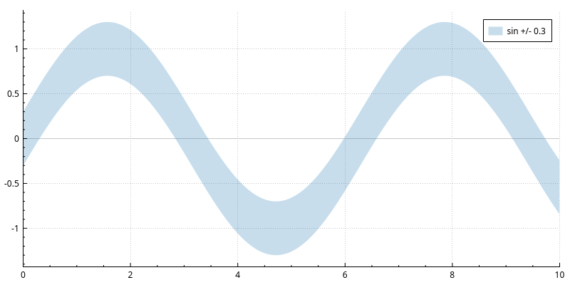

Fills are also available on any line graph, one column at a time. `set_fill_to_value` fills between a line and a constant. `set_fill_between` fills between two columns of the same graph.

```python
import numpy as np
from SciQLopPlots import GraphLineStyle, SciQLopPlot

plot = SciQLopPlot()
x = np.linspace(0, 10, 10_000)
y = np.sin(x)
graph = plot.plot(x, np.column_stack([y, y - 0.3, y + 0.3]), labels=["y", "low", "high"])
graph.set_column_line_style(1, GraphLineStyle.NoLine)
graph.set_column_line_style(2, GraphLineStyle.NoLine)
graph.set_fill_between(1, 2)
graph.set_fill_to_value(0, 0.0)
```

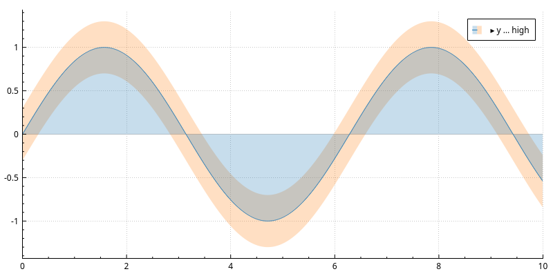

`graph.clear_fill(column)` removes a fill. `set_fill_color(column, color)` changes its colour.

Both columns must belong to the same graph. To shade between two spacecraft, build one virtual product that returns both curves as columns.

For an uncertainty around a curve, pass `[y, y - e, y + e]` and call `set_fill_between(1, 2)`, as above. Or let `plot.error_bars` do it:

```python
import numpy as np
from SciQLopPlots import SciQLopPlot

plot = SciQLopPlot()
x = np.linspace(0, 10, 25)
plot.error_bars(x, np.sin(x), 0.1)
plot.error_bars(x, np.cos(x), 0.1, 0.3, name="asymmetric")
plot.x_axis().set_range(-0.5, 10.5)
```

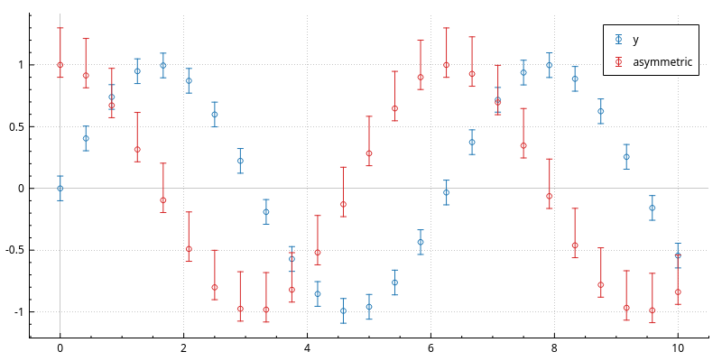

One error gives symmetric bars. Two give the lower and the upper error. Errors are a scalar or one value per point.

Bars are drawn while there is room for them. Zoom out, or pass many points, and they merge into a band:

```python
import numpy as np
from SciQLopPlots import SciQLopPlot

plot = SciQLopPlot()
x = np.linspace(0, 10, 2000)
plot.error_bars(x, np.sin(x), 0.02 + 0.03 * x, name="dense")   # the error grows with x
```

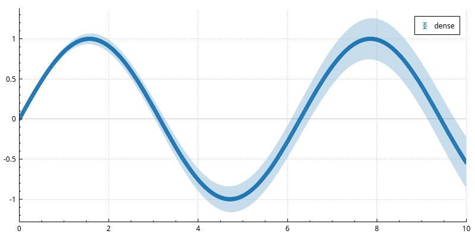

A band is downsampled like any line. Zoomed out, it spans between the drawn min/max lines, not between every raw point.

Both `band` and `error_bars` also accept a data function, as in the next sections. It returns arrays, not the `{"data", "color"}` form.

### Scatter

```python
import numpy as np
from SciQLopPlots import SciQLopPlot, GraphType

plot = SciQLopPlot()
rng = np.random.default_rng(0)
x = np.sort(rng.uniform(0, 10, 500))
plot.plot(x, np.sin(x) + rng.normal(0, 0.1, 500), graph_type=GraphType.Scatter, labels=["noisy"])
```

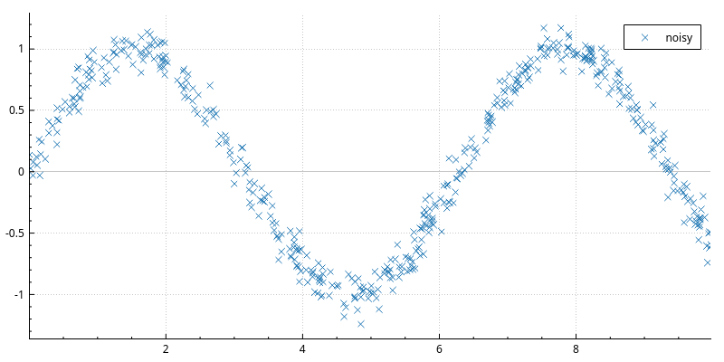

### Colour maps (spectrograms)

```python
import numpy as np
from SciQLopPlots import SciQLopPlot, ColorGradient

plot = SciQLopPlot()
x = np.linspace(0, 100, 400)          # e.g. time, shape (nx,)
y = np.logspace(0, 3, 64)             # e.g. energy, shape (ny,)
z = np.outer(np.sin(x / 10) + 2, 1 / y)   # shape (nx, ny): z[i, j] is at (x[i], y[j])

cmap = plot.plot(x, y, z, name="spectrogram")
cmap.set_gradient(ColorGradient.Viridis)
cmap.set_y_log_scale(True)
cmap.set_z_log_scale(True)
plot.set_title("Electron flux")
```

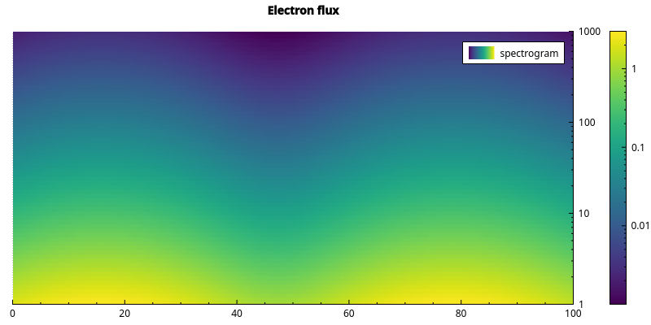

`z` has one row per `x` value and one column per `y` value. `y` may also have `z`'s shape, when the y channels change over time (a varying energy table, for example).

On a log colour scale, pixels that cover several samples are averaged in log space. So zoomed-out spectrograms look like the zoomed-in ones.

### Parametric curves

For data where `x` goes back and forth, like an orbit or a hodogram:

```python
import numpy as np
from SciQLopPlots import SciQLopPlot, GraphType

plot = SciQLopPlot()
t = np.linspace(0, 12 * np.pi, 5000)
r = np.exp(np.cos(t)) - 2 * np.cos(4 * t)
plot.plot(r * np.sin(t), r * np.cos(t), graph_type=GraphType.ParametricCurve, labels=["butterfly"])
plot.rescale_axes()
```

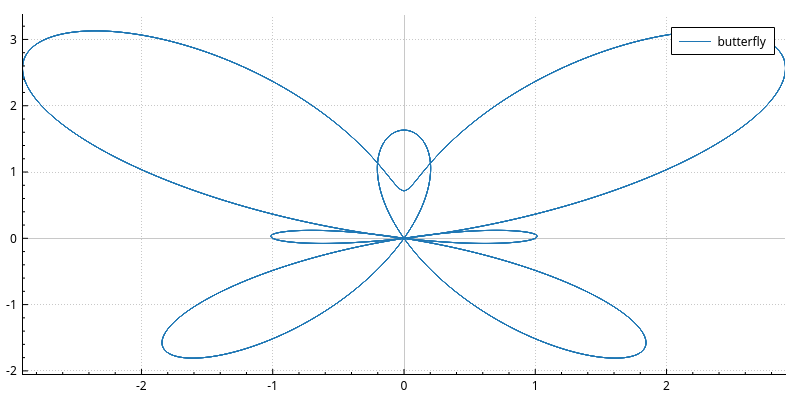

### Waterfall

Stacks each column of `y` with an offset, for channel stacks or seismic-style record sections:

```python
import numpy as np
from SciQLopPlots import SciQLopPlot, GraphType

plot = SciQLopPlot()
t = np.linspace(0, 10, 2000)
y = np.column_stack([np.sin(2 * np.pi * (0.5 + 0.3 * i) * t) for i in range(8)])
wf = plot.plot(t, y, graph_type=GraphType.Waterfall,
               offsets=2.5,        # spacing between traces, or one offset per trace
               normalize=True,     # scale each trace to the same height
               gain=1.0,
               labels=[f"ch{i}" for i in range(8)])
wf.set_gain(2.0)   # change it later; the plot follows
```

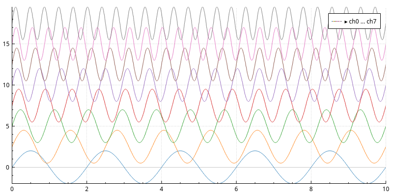

### 2-D histograms

Bins scattered points into a density map:

```python
import numpy as np
from SciQLopPlots import SciQLopPlot

plot = SciQLopPlot()
rng = np.random.default_rng(42)
x, y = rng.normal(0, 1, 100_000), rng.normal(0, 0.5, 100_000)
hist = plot.add_histogram2d("density", 80, 80)   # name, x bins, y bins
hist.set_data(x, y)
plot.x_axis().set_range(-4, 4)
plot.y_axis().set_range(-2, 2)
```

`plot.plot(x, y, graph_type=GraphType.Histogram2D)` works too; `add_histogram2d` also sets the bin counts.

A callable `plot.histogram2d(callback)` on a plain plot fetches nothing until `plot.time_axis()` has a range, like the 1-D histograms below.

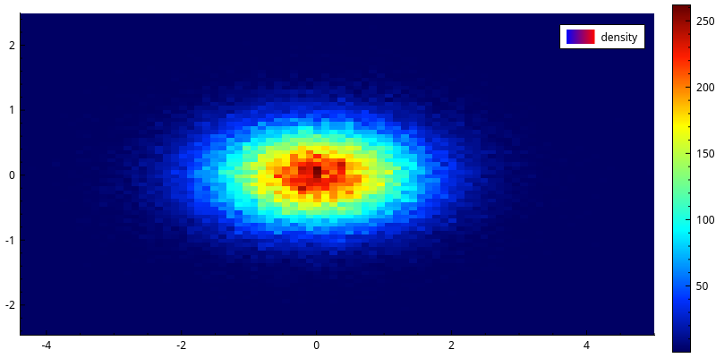

### Histograms

`plot.histogram(values)` counts values into bins and draws the counts. The x axis holds the values. The y axis holds the counts.

```python
import numpy as np
from SciQLopPlots import SciQLopPlot

plot = SciQLopPlot()
values = np.random.default_rng(42).normal(0, 1, 100_000)
hist = plot.histogram(values, bins=50, name="speed")
```

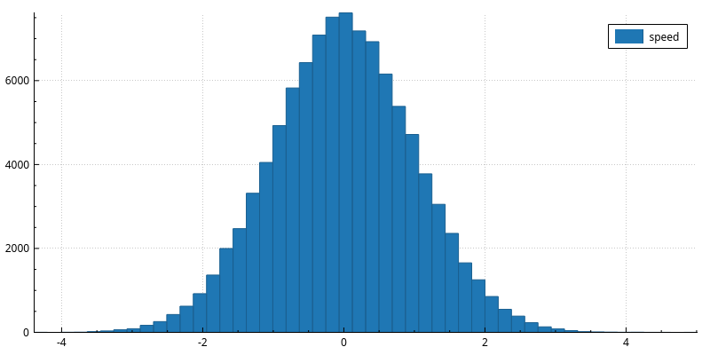

One column of values is drawn as bars. Several columns are drawn as step outlines, one per column. Pass `style=HistogramStyle.Bars` or `style=HistogramStyle.Step` to choose. An explicit style always wins.

```python
import numpy as np
from SciQLopPlots import SciQLopPlot

plot = SciQLopPlot()
rng = np.random.default_rng(42)
values = np.column_stack([rng.normal(0, 1, 50_000), rng.normal(1.5, 0.7, 50_000)])
hist = plot.histogram(values, bins=60, name="two populations")
```

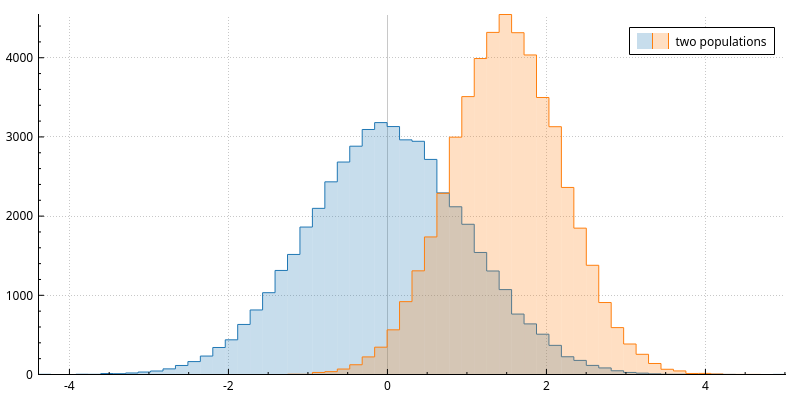

`range=(lower, upper)` fixes the edges. Values outside the range are not counted.

```python
import numpy as np
from SciQLopPlots import SciQLopPlot

plot = SciQLopPlot()
values = np.random.default_rng(42).normal(0, 1, 100_000)
hist = plot.histogram(values, bins=40, range=(-2.0, 2.0))
```

Without `range`, the edges follow the data. They only widen, so a bar never disappears when the data shrinks. `hist.reset_edges()` forgets the widest range and fits the data again.

`log_bins=True` makes the bins equally wide in log space. It also sets the x axis to log. Log bins need positive values.

```python
import numpy as np
from SciQLopPlots import HistogramNormalization, SciQLopPlot

plot = SciQLopPlot()
values = np.random.default_rng(42).lognormal(0, 1, 100_000)
hist = plot.histogram(values, bins=60, log_bins=True,
                      normalization=HistogramNormalization.Density)
```

`normalization` sets what the bars show:

- `HistogramNormalization.Count`: the number of values in each bin. This is the default.
- `HistogramNormalization.Density`: the count divided by the bin width. The area under the bars is 1.
- `HistogramNormalization.Probability`: the count divided by the total. The heights add up to 1.

Give `histogram` a function and it follows the time range. The function receives `(start, stop)` and returns `(t, values)` for that window, like any live data function.

```python
import numpy as np
from SciQLopPlots import SciQLopMultiPlotPanel

panel = SciQLopMultiPlotPanel(synchronize_x=False, synchronize_time=True)

def signal(start, stop):
    t = np.linspace(start, stop, 10_000)
    return t, np.sin(t) + np.random.default_rng(0).normal(0, 0.1, t.size)

line_plot, line = panel.plot(signal)
hist_plot, hist = panel.histogram(signal, bins=40)
panel.set_time_axis_range(0.0, 100.0)
```

The histogram counts the values inside the panel's time range. The panel's x axis is the time. The histogram's own x axis is the value, so the panel does not drag it along.

A panel that holds only histograms has no line plot to set the time. Call `panel.set_time_axis_range(start, stop)` yourself.

A histogram on a standalone plot fetches nothing at first. Set the time with `plot.time_axis().set_range(start, stop)` to start it.

```python
import numpy as np
from SciQLopPlots import SciQLopPlot

plot = SciQLopPlot()

def values(start, stop):
    t = np.linspace(start, stop, 5_000)
    return t, np.sin(t)

hist = plot.histogram(values, bins=30)
plot.time_axis().set_range(0.0, 50.0)
```

A `SciQLopTimeSeriesPlot` cannot hold a histogram: its x axis is the time. `histogram` and `bars` raise `NotImplementedError` there. Use a `SciQLopPlot`, or `panel.histogram`, which makes one.

Data that is already binned goes through `plot.bars(edges, heights)`. There must be one more edge than there are heights. A 2-D `heights` gives one step outline per column.

```python
import numpy as np
from SciQLopPlots import SciQLopPlot

plot = SciQLopPlot()
edges = np.array([0.0, 1.0, 2.0, 5.0, 10.0])
heights = np.array([4.0, 9.0, 3.0, 1.0])
bars = plot.bars(edges, heights, name="pre-binned")
```

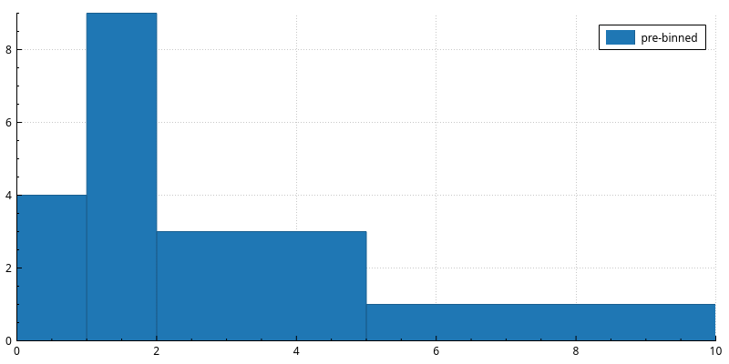

## Live data: plot a function

Instead of arrays, give `plot()` a function. It receives the visible range as `(start, stop)` and returns the data for it. On every pan or zoom, it is called again for the new range.

This is how you plot data that is too big to load at once, or that comes from a server.

```python
import numpy as np
from SciQLopPlots import SciQLopPlot

def get_data(start, stop):
    x = np.linspace(start, stop, 10_000)
    return x, np.column_stack([np.sin(x), np.cos(x)])

plot = SciQLopPlot()
graph = plot.plot(get_data, labels=["sin", "cos"])
plot.x_axis().set_range(0, 100)   # triggers a call with (0, 100)
```

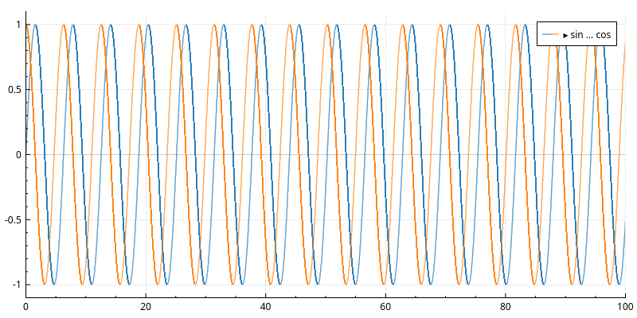

What the function may return:

- `x, y`: line graph data, as for static plots. Return `x, y, z` for a colour map (use `graph_type=GraphType.ColorMap`).
- `{"data": [x, y], "color": c}`: the same, plus one colour value per sample, to colour the line by a third quantity.
- `None` or empty arrays: nothing to show for that range.

Things to know:

- **It runs in a background thread**, so the window stays responsive while it works. Don't touch widgets from it; just compute and return arrays.
- **Calls are coalesced.** A fast drag does not queue up hundreds of calls; only the latest range is fetched.
- **`graph.busy()`** is true while a fetch is in flight. When it lasts more than half a second, the graph fades slightly as a hint.
- **The same range is not fetched twice.** If your source changed (new parameters, fresh data), call `graph.invalidate_cache()` and the next request fetches again.

### Fetch a margin around the view

By default each request asks exactly for the visible range, so a small pan fetches everything again. If your function returns the same data for a range whatever the span asked (raw samples from a file or a server), let it fetch a margin:

```python
import numpy as np
from SciQLopPlots import SciQLopPlot

def raw_samples(start, stop):
    x = np.arange(np.floor(start), np.ceil(stop), 0.01)
    return x, np.sin(x)

plot = SciQLopPlot()
graph = plot.plot(raw_samples, labels=["raw"])
graph.set_prefetch_margin(0.5)   # fetch the view plus half its width on each side
```

Then pans and zooms that stay inside what was loaded cost nothing. Leave the margin at 0 for functions whose answer depends on the span: one that always returns 1000 points, for example, would stay coarse after a zoom-in.

### Colour a line by a third quantity

```python
import numpy as np
from SciQLopPlots import SciQLopPlot, ColorGradient

plot = SciQLopPlot()
x = np.linspace(0, 10, 2000)
graph = plot.plot(x, np.sin(x), labels=["sin"])
graph.set_color_data(np.cos(x), ColorGradient.Plasma)   # one value per x sample
```

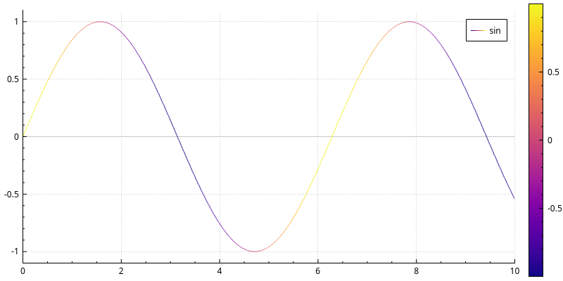

The plot shows a colour scale for it. Pass an empty array to go back to a plain line.

A data function can send the colour values with each batch:

```python
import numpy as np
from SciQLopPlots import SciQLopPlot, ColorGradient

def speed_coloured(start, stop):
    x = np.linspace(start, stop, 5000)
    return {"data": [x, np.sin(x)], "color": np.abs(np.cos(x))}

plot = SciQLopPlot()
graph = plot.plot(speed_coloured, labels=["position"])
graph.set_color_gradient(ColorGradient.Turbo)
plot.x_axis().set_range(0, 20)
```

## Time series

For time on the x axis, use seconds since 1970-01-01 UTC (Unix time) as `float64`. Then ask for a time series plot: the x axis shows dates and times.

```python
from datetime import datetime, timezone
import numpy as np
from SciQLopPlots import SciQLopTimeSeriesPlot, SciQLopPlotRange

start = datetime(2025, 4, 12, tzinfo=timezone.utc).timestamp()
t = start + np.arange(0, 86400, 4.5)                       # one day, 4.5 s cadence
plot = SciQLopTimeSeriesPlot()
plot.x_axis().set_range(SciQLopPlotRange(start, start + 3 * 3600))   # first 3 hours
plot.plot(t, np.sin(2 * np.pi * (t - start) / 3600), labels=["hourly wave"])
```

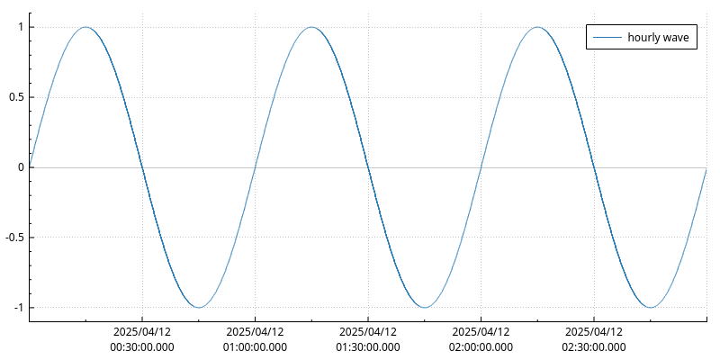

A time series plot never moves its time axis by itself: you choose the time range. It fits the y axis to the data in that range, so set the range first, or call `plot.y_axis().rescale()` after changing it.

With NumPy `datetime64` data, convert first: `t = times.astype("datetime64[ns]").astype(np.int64) / 1e9`.

Time ranges are more lenient than data. `SciQLopPlotRange(start, stop)`, `axis.set_range`, a time series plot's `set_time_range` and `panel.set_time_axis_range` also take `np.datetime64` (any unit), `datetime`, `date` or an ISO string. All of them mean UTC: a `datetime` without a time zone counts as UTC, not local time.

## Several plots in a panel

`SciQLopMultiPlotPanel` stacks plots vertically and keeps their x (or time) axes in sync. It's the usual layout for comparing several quantities over the same time range.

```python
from datetime import datetime, timezone
import numpy as np
from SciQLopPlots import SciQLopMultiPlotPanel, PlotType

def magnetic_field(start, stop):
    t = np.arange(start, stop, 1.0)
    return t, np.column_stack([np.sin(t / 600), np.cos(t / 600), np.sin(t / 300)])

def density(start, stop):
    t = np.arange(start, stop, 4.0)
    return t, 5 + np.sin(t / 1800)

panel = SciQLopMultiPlotPanel(synchronize_x=False, synchronize_time=True)
b_plot, b_graph = panel.plot(magnetic_field, labels=["Bx", "By", "Bz"], plot_type=PlotType.TimeSeries)
n_plot, n_graph = panel.plot(density, labels=["N"], plot_type=PlotType.TimeSeries)

start = datetime(2025, 4, 12, tzinfo=timezone.utc).timestamp()
panel.set_time_axis_range(start, start + 6 * 3600)   # every plot follows
```

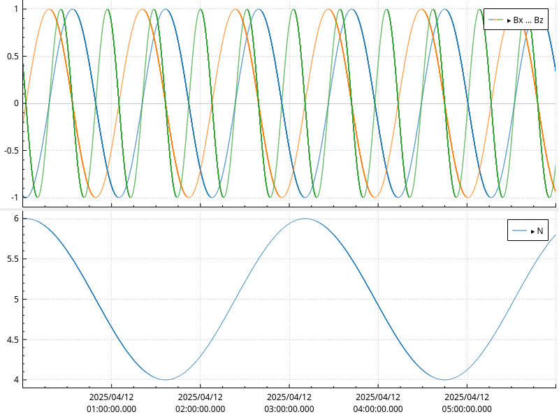

- On a panel, **`plot()` returns `(plot, graph)`**: the new plot and the graph in it.
- **`synchronize_time=True`** links the time axes of time series plots. **`synchronize_x=True`** links plain x axes instead.
- `panel.plot_at(i)`, `panel.plots()` and `panel.plot_count()` give access to the plots.

To add a graph to an existing plot of the panel, call `plot()` on that plot instead of on the panel.

### Other widgets in a panel

`WidgetPlot` puts any Qt widget in a panel, as a row of its own: a matplotlib figure, a Qt Graphs view, a Qt 3D scene. The row follows the panel's range: after every pan or zoom, `on_time_range(start, stop)` gets the new range, to redraw the widget.

```python
import numpy as np
from PySide6.QtWidgets import QLabel
from SciQLopPlots import PlotType, SciQLopMultiPlotPanel, WidgetPlot

t = 1.7e9 + np.linspace(0, 3600, 10_000)
bx = np.sin(t / 300)

panel = SciQLopMultiPlotPanel(synchronize_x=False, synchronize_time=True)
panel.set_time_axis_range(t[0], t[-1])                 # before plotting: plots fit what is in view
panel.plot(t, bx, labels=["Bx"], plot_type=PlotType.TimeSeries)

label = QLabel()
def show_mean(start, stop):
    in_view = bx[(t >= start) & (t <= stop)]
    label.setText(f"mean Bx in view: {in_view.mean():.3f}")

panel.add_plot(WidgetPlot(label, on_time_range=show_mean))
```

Instead of passing `on_time_range`, a subclass of `WidgetPlot` can override the method. The row only hosts the widget: crosshairs, margin alignment and themes apply to the panel's own plots, not to it.

Three examples are ready to copy, in [`tests/manual-tests/advanced`](https://github.com/SciQLop/SciQLopPlots/tree/main/tests/manual-tests/advanced):

**`embed_matplotlib.py`**: a histogram of the values in view, redrawn by matplotlib after every pan or zoom.

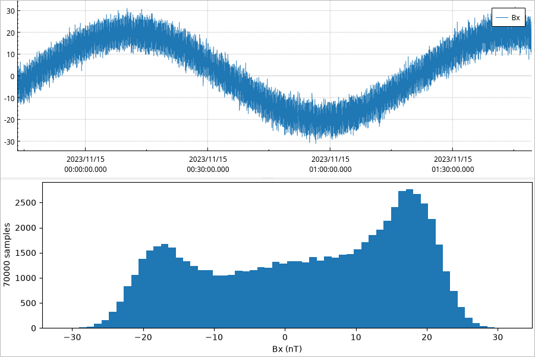

**`embed_qtgraphs.py`**: the spectrogram in view as a Qt Graphs 3-D surface of time, energy and flux.

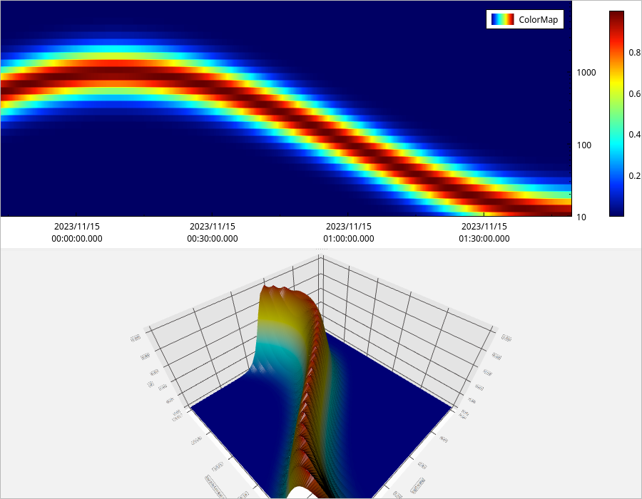

**`embed_qt3d.py`**: a Qt 3D scene, with the spacecraft where it is at the middle of the view.

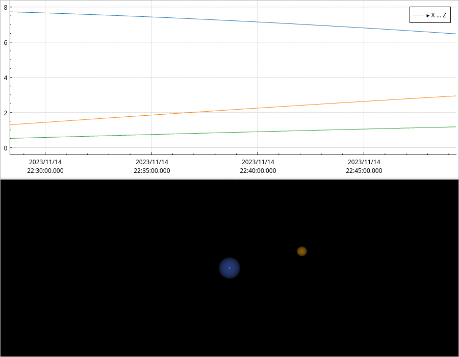

Two lifetime rules, both handled and commented in the examples:

- **Qt 3D**: give each mesh, material and transform its entity as parent. `addComponent()` does not keep them alive, and Python would delete them: the scene stays black.
- **Qt Graphs**: delete the graph item (`Q3DSurfaceWidgetItem`, `Q3DBarsWidgetItem`, ...) before its `QQuickWidget`, for example on `QApplication.aboutToQuit`. Deleted after it, the item crashes the application on exit.

## Axes

Each plot has `x_axis()`, `y_axis()`, a second pair `x2_axis()` / `y2_axis()` (top and right), and `z_axis()` for colour scales.

```python
import numpy as np
from SciQLopPlots import SciQLopPlot

plot = SciQLopPlot()
x = np.linspace(1, 1000, 1000)
plot.plot(x, x ** 2, labels=["x²"])

plot.x_axis().set_label("distance [km]")
plot.y_axis().set_label("area [km$^2$]")   # $...$ is rendered as LaTeX
plot.y_axis().set_log(True)
plot.x_axis().set_range(1, 1000)
plot.y_axis().rescale()                      # fit the data on this axis
r = plot.x_axis().range()
print(r.start(), r.stop(), r.size())
```

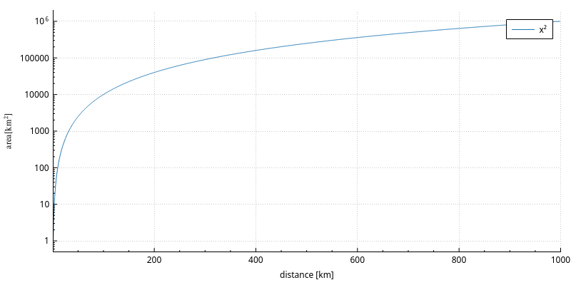

- `plot.rescale_axes()` fits every axis to the data.
- A graph's first data fits the axes on its own. `plot.set_fit_first_data(False)` keeps the ranges you set instead; `rescale_axes()` still works.
- Rescaling leaves a 5% margin on each side of a value axis, so ticks at the data's ends (0/1 flags, enum levels) keep their labels. `axis.set_autoscale_margin(0.1)` changes it at runtime (0 to 0.5; in decades on a log axis), and so does the axis's inspector panel. Time axes, key axes and axes holding a colormap or histogram are never padded.
- `axis.set_min_range_size(s)` / `set_max_range_size(s)` limit how far a user can zoom.

## Colours, names and themes

```python
import numpy as np
from PySide6.QtGui import QColorConstants
from SciQLopPlots import SciQLopPlot, SciQLopTheme, ColorGradient

plot = SciQLopPlot()
x = np.linspace(0, 10, 100)
graph = plot.plot(x, np.column_stack([np.sin(x), np.cos(x)]), labels=["a", "b"])

graph.set_labels(["sine", "cosine"])                   # legend names
graph.set_colors([QColorConstants.Magenta, QColorConstants.Cyan])
graph.set_name("trig")                                 # the graph's own name
plot.set_title("Trigonometry")                         # a title above the plot area ("" removes it)
plot.set_theme(SciQLopTheme.dark(plot))                # or SciQLopTheme.light(plot)
plot.set_z_gradient(ColorGradient.Cividis)             # gradient for colour-coded data
```

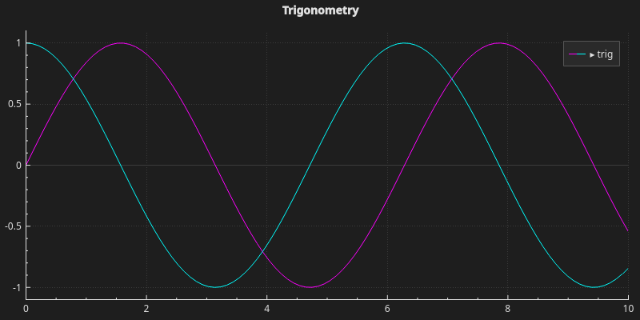

Available gradients (`ColorGradient`): Viridis, Cividis, Magma, Inferno, Plasma and Turbo (perceptually uniform, colour-blind friendly), Coolwarm (diverging), plus the classic Jet, Hot, Cold, Grayscale, Spectrum, Thermal, Polar, Hues, Candy, Ion, Night and Geography.

A panel takes a theme too: `panel.set_theme(SciQLopTheme.dark(panel))`.

### Visible, selected, name and colour

Everything drawn answers the same four questions, with the same signals. That covers graphs and
their components, colour maps, histograms, timelines, items, spans, groups and the legend.

```python
import numpy as np
from PySide6.QtCore import QPointF
from SciQLopPlots import SciQLopPlot, SciQLopTextItem

plot = SciQLopPlot()
x = np.linspace(0, 10, 100)
graph = plot.plot(x, np.sin(x), labels=["sin"])
note = SciQLopTextItem(plot, "peak", QPointF(20, 20))

note.visible_changed.connect(lambda visible: print("note visible:", visible))
note.set_visible(False)                         # visible / set_visible / visible_changed
note.set_selected(True)                         # selected / set_selected / selection_changed
note.set_name("marker")                         # name / set_name / name_changed
note.set_color(graph.component(0).color())      # color / set_color / color_changed
graph.name = "sine"                             # a plottable's name is a property
try:
    graph.color()                               # a graph has one colour per line
except NotImplementedError as error:
    print(error)                                # "... use colors()"
```

- A setter signals once per change and stays silent when the value is the same. Called from
  another thread, it runs on the GUI thread a moment later.
- A graph or group signals once all its lines or members have changed.
- A graph hidden or selected before its first data stays hidden or selected when the data comes.
- `color_changed` also fires when another setter moves the colour, such as `set_pen`.
- What a kind can't do raises `NotImplementedError` naming the class: a group's colour, a
  pixmap's colour, a panel line's selection.
- Deprecated names still work: `span.selectionChanged` (use `selection_changed`),
  `legend.is_visible()` and `legend.visibility_changed` (use `visible()` and `visible_changed`).
- C++ subclasses: override the protected hooks (`_visible`, `_set_visible`, ...), not the
  accessors, and without `noexcept`.

## Legends

Every graph gets a legend row. Two calls keep a busy legend short.

A group shows several plottables as one row, under its own name. Double-clicking the row hides or shows them all:

```python
import numpy as np
from SciQLopPlots import SciQLopPlot

plot = SciQLopPlot()
x = np.linspace(0, 10, 100)
centre = plot.plot(x, np.sin(x), labels=["median"])
low = plot.plot(x, np.sin(x) - 0.2, labels=["min"])
high = plot.plot(x, np.sin(x) + 0.2, labels=["max"])

model = plot.group("model", [centre, low, high])   # one row: "model"
model.add(plot.plot(x, np.cos(x), labels=["extra"]))
model.set_visible(False)                           # hides the four members
model.set_visible(True)
plot.remove_group(model)                           # the four rows come back

outline = plot.plot(x, 0 * x, labels=["zero"])
outline.set_in_legend(False)                       # a decoration: no row at all
print(plot.legend().row_labels())                  # ['median', 'min', 'max', 'extra']
```

- A group holds its members, it doesn't own them: deleting a member just takes it out of the group.
- `set_visible` acts on the members present now; a member added later keeps its own visibility.
- Members must belong to the plot that made the group, otherwise `ValueError`.
- `set_in_legend(False)` also holds after a member leaves its group.
- `legend.row_labels()` and `legend.row_rect(i)` tell what the legend shows and where, for tests.

Place the legend in a corner, at a point, or with its entries side by side:

```python
import numpy as np
from PySide6.QtCore import QPointF, Qt
from SciQLopPlots import SciQLopMultiPlotPanel, SciQLopPlot

plot = SciQLopPlot()
x = np.linspace(0, 10, 100)
for k in range(3):
    plot.plot(x, np.sin(x + k), labels=[f"phase {k}"])

plot.legend().set_alignment(Qt.AlignBottom | Qt.AlignLeft)   # a corner or an edge
plot.legend().set_position(QPointF(0.6, 0.1))   # top-left corner, in fractions of the plot area
plot.legend().set_columns(3)                    # entries side by side

panel = SciQLopMultiPlotPanel()
panel.set_legend_visible(False)                 # every plot's legend, later ones too
```

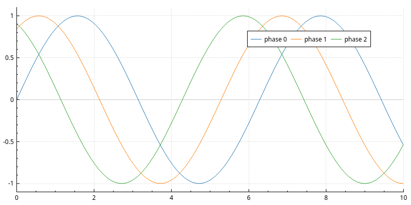

## Overlays: spans, lines and text

```python
import numpy as np
from PySide6.QtCore import QPointF
from PySide6.QtGui import QColor
from SciQLopPlots import (SciQLopPlot, SciQLopPlotRange, SciQLopVerticalSpan,
                          SciQLopHorizontalLine, SciQLopTextItem, Coordinates)

plot = SciQLopPlot()
x = np.linspace(0, 10, 1000)
plot.plot(x, np.sin(x), labels=["sin"])

# A shaded x interval the user can drag and resize
span = SciQLopVerticalSpan(plot, SciQLopPlotRange(2.0, 4.0), QColor(100, 100, 220, 80),
                           read_only=False, visible=True, tool_tip="event")
span.range_changed.connect(lambda r: print("span now", r.start(), r.stop()))

# A threshold line at y = 0.5
threshold = SciQLopHorizontalLine(plot, 0.5)

# A text label placed in data coordinates
note = SciQLopTextItem(plot, "peak", QPointF(1.57, 1.0), movable=False, coordinates=Coordinates.Data)
```

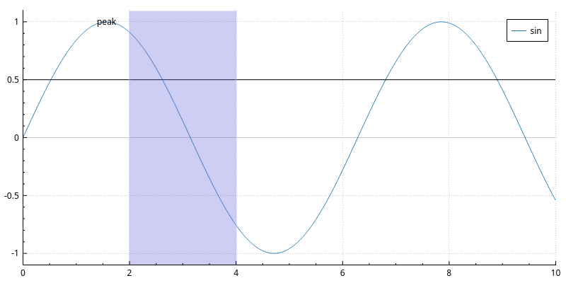

- On a panel, `MultiPlotsVerticalSpan(panel, range, color, ...)` draws one span across every plot. That's handy for marking an event in time. Read and set its state as attributes: `span.selected = True`, `span.visible`, `span.color`, `span.read_only`, `span.id`.
- `SciQLopVerticalLine`, `SciQLopRectangularSpan`, `SciQLopEllipseItem` and `SciQLopPixmapItem` follow the same pattern.
- Text, line, ellipse and pixmap items have `selected()` / `set_selected()` and `name()` / `set_name()` too. Text, pixmap and curved-line tooltips work, and so does `set_movable` on text, ellipse and pixmap.

`MultiPlotsVerticalLine` draws one vertical line across every plot of a panel, including plots added later. It makes a good time cursor:

```python
import numpy as np
from PySide6.QtGui import QColor
from SciQLopPlots import SciQLopMultiPlotPanel, MultiPlotsVerticalLine

panel = SciQLopMultiPlotPanel()
x = np.linspace(0, 10, 1000)
panel.plot(x, np.sin(x), labels=["sin"])
panel.plot(x, np.cos(x), labels=["cos"])

cursor = MultiPlotsVerticalLine(panel, 2.0, tool_tip="cursor")
cursor.position_changed.connect(lambda t: print("cursor at", t))
cursor.position = 5.0          # moves it on every plot
cursor.color = QColor("red")   # also line_width, visible, read_only, tooltip
```

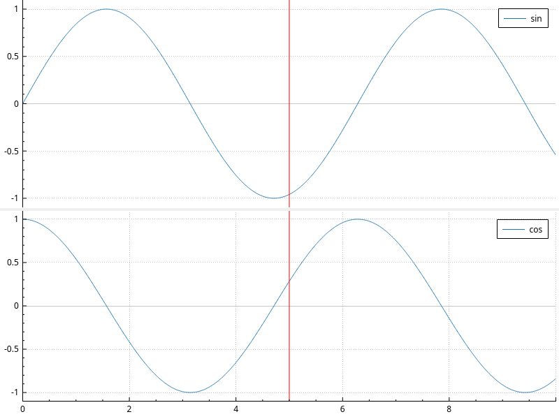

Dragging the line on any plot moves it on all of them, and `position_changed` fires once per move. With `read_only=True` the user can't drag it.

## Interval timelines

A timeline shows intervals — events, instrument modes, catalog entries — as coloured bars on named lanes. `panel.add_timeline()` gives a compact, dedicated plot for them:

```python
import numpy as np
from PySide6.QtGui import QColor
from SciQLopPlots import SciQLopMultiPlotPanel

panel = SciQLopMultiPlotPanel(synchronize_time=True)
plot, tl = panel.add_timeline()

start = np.array([0, 3600, 9000], dtype=np.float64)
stop = np.array([1800, 7200, 10800], dtype=np.float64)
tl.set_intervals(start, stop, lane=["MSA", "MGF", "MSA"],
                 category=["LM", "survey", "burst"],
                 label=["low mass", "survey mode", "burst mode"])
tl.set_category_colors({"LM": QColor("#f59e0b"), "survey": QColor("#3b82f6")})
panel.set_time_axis_range(0, 12000)
```

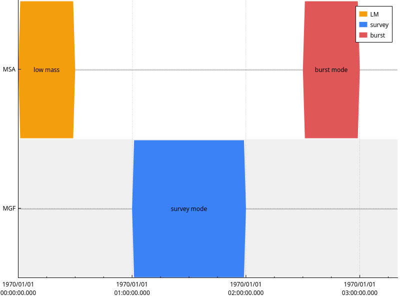

- `panel.add_timeline()` returns `(plot, timeline)`: a time-series plot sized to its lanes, and the timeline plottable to feed. `lane_height` (22 px by default) is a minimum: make the plot taller and the lanes grow with it. `panel.organize_plots()` gives timeline plots their natural height and shares the rest.
- `set_intervals(start, stop, lane=..., category=..., label=..., ids=...)` takes epoch seconds or `datetime64` arrays; a missing `stop` defaults to `start`. Lane and category names are kept in first-seen order.
- Timelines are drawn like a logic analyzer's wave view: bus-shaped bars with angled ends, an idle line through each lane, and every other lane shaded. Labels are centred in the visible part of each bar and shortened with "…" when they don't fit. `tl.style = "bars"` switches to plain bars.
- `tl.lanes` reads the displayed lanes; `tl.lanes = [...]` reorders them or hides the ones left out. `tl.rename_lane(old, new)` renames one; `tl.count()` gives the number of intervals. Category colours are shared by every timeline: `tl.category_color("LM")` reads one back. The legend lists the categories in use, each with its colour.
- Overlapping intervals in one lane:
  - `tl.stack = None` (the default) draws them over each other.
  - `tl.stack = "time"` puts each in the first free sub-row; good for overlapping events.
  - `tl.stack = "category"` gives each category its own fixed sub-row, named at its start, so an instrument's modes keep their rows from one orbit to the next. `tl.category_order = ["BASE", "HKM", "LM"]` sets the row order; categories left out follow, first seen first.
  - Each sub-row is a full `lane_height`, so a lane with 4 modes is 4 rows tall. For about 70 rows on a 1080 px screen, use `lane_height=14`; below about 12 px, labels no longer fit in their bars.
  - `tl.forbid_overlap = True` makes edits stop at the neighbouring block in the same row, so they never overlap: the same lane, or the same lane and category with `stack="category"`. A move of several selected blocks is limited by the tightest one, and a block moves to another lane only if it fits where it is dropped.
- Timelines show up in the inspector, as "timeline" or their name (`tl.set_name(...)`). Their properties panel sets the style, stacking, forbidden overlaps, lane height, editing and snapping.

A timeline also works as a strip on a regular plot, stacked next to the data:

```python
import numpy as np
from SciQLopPlots import SciQLopTimeSeriesPlot

plot = SciQLopTimeSeriesPlot()
plot.x_axis().set_range(0, 10000)
t = np.linspace(0, 10000, 2000)
plot.plot(t, np.sin(t / 500), labels=["signal"])

strip = plot.add_timeline(lane_height=12)
strip.set_intervals([500, 4000], [3000, 6000], lane=["quiet", "quiet"], category=["ok", "ok"])
```

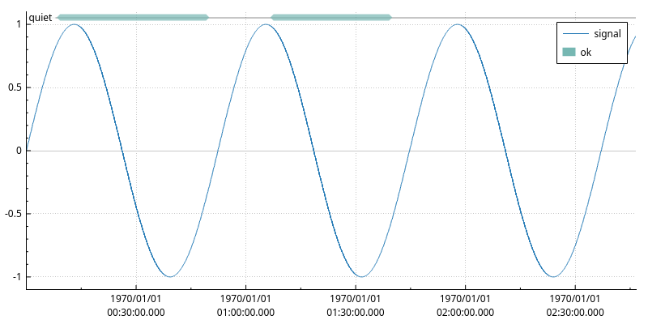

In a strip, lanes keep their `lane_height` and the lane names sit on a small background chip, so the data and the bars never cover them. A line graph added to a timeline plot goes to the right y axis automatically, so the lane names on the left stay readable.

Make a timeline editable to build or adjust a plan by hand, and write edits back into your own data:

```python
import numpy as np
from SciQLopPlots import SciQLopTimeSeriesPlot

plot = SciQLopTimeSeriesPlot()
tl = plot.add_timeline()

plan = {"start": np.array([0.0, 3600.0]), "stop": np.array([1800.0, 7200.0]),
        "lane": ["A", "B"], "ids": np.array([1, 2])}
tl.set_intervals(**plan)

tl.editable = True
tl.edit_modes = {"move", "resize", "change_lane"}
tl.snap_to = 60   # snap drags to the nearest minute; also "edges", a list of times, or None

def apply_edits(edits):
    by_id = {i: (new_start, new_stop, new_lane) for i, new_start, new_stop, new_lane in edits}
    for row, interval_id in enumerate(plan["ids"]):
        if interval_id in by_id:
            plan["start"][row], plan["stop"][row], plan["lane"][row] = by_id[interval_id]
    tl.set_intervals(**plan)   # the single source of truth stays in sync

tl.intervals_changed.connect(apply_edits)
```

- `tl.editable = True` turns on mouse editing. `edit_modes` picks which gestures are allowed (default `{"move", "resize"}`); add `"change_lane"` to let a drag move an interval to another lane, `"create"` to draw new ones on empty lane space, `"delete"` to wire the Delete key to `delete_requested`.
- Drag a block's end to resize it. A block too narrow to grab is resized from just outside its ends; pressing inside it moves it. Instant events (start == stop) only move.
- Shift+drag on empty lane space makes a rubber-band selection; Ctrl-click toggles one interval; arrow keys nudge the selection; Escape cancels a drag in progress.
- `tl.intervals_changed` fires with every edited interval as `[id, start, stop, lane_name]` — the pattern above folds them back into the arrays and calls `set_intervals` again. `tl.interval_created` fires with `(start, stop, lane_name)` when an interval is drawn on empty lane space, and `tl.interval_created_in` with `(start, stop, lane_name, category)`: the category of the row it was drawn in with `stack="category"`, else `""`; `tl.delete_requested` fires with the list of selected ids when Delete or Backspace is pressed. Neither changes the data: add or drop the intervals in your arrays and call `set_intervals` again.
- `tl.snap_to = [t1, t2, ...]` snaps dragged edges to those times only (epoch seconds or `datetime64`), e.g. orbit events.
- `tl.hovered` fires with the hovered interval's id (or `-1` when the mouse leaves it), and `tl.interval(id)` gives its details as a dict: `id`, `start`, `stop`, `duration`, `lane`, `category` and `label` (`None` for an unknown id); `tl.selected_intervals_changed`, `tl.selected_ids()` and `tl.select_ids([...])` track and drive the selection.
- `tl.interval_at(x, y)` gives the id of the interval under a widget pixel, or `None`. The plot's crosshair tooltip lists the hovered interval: lane, label (category), start → stop; `plot.crosshair_text()` returns that tooltip's text.

## Reactive pipelines

Plot objects expose some properties under `.on`. Connect them with `>>` to build live links, optionally through a function.

```python
import numpy as np
from PySide6.QtGui import QColor
from SciQLopPlots import SciQLopPlot, SciQLopVerticalSpan, SciQLopPlotRange

plot = SciQLopPlot()
x = np.linspace(0, 10, 1000)
plot.plot(x, np.sin(x), labels=["sin"])
span = SciQLopVerticalSpan(plot, SciQLopPlotRange(2.0, 4.0), QColor(100, 200, 100, 80),
                           read_only=False, visible=True, tool_tip="")

def describe(event):
    r = event.value
    return f"{r.start():.2f} .. {r.stop():.2f}"

span.on.range >> describe >> span.on.tooltip        # tooltip follows the span

zoomed = SciQLopPlot()
zoomed.plot(x, np.sin(x), labels=["zoom"])
span.on.range >> zoomed.x_axis().on.range           # second plot shows the span's interval
```

The function receives an event whose `.value` is the new value, and returns what to send on; returning `None` sends nothing. Observable properties include:

- `axis.on.range`
- `span.on.range` and `span.on.tooltip`
- `graph.on.data`
- the waterfall settings: `offset_mode`, `offsets`, `spacing`, `normalize`, `gain`

## N-D projections

`SciQLopNDProjectionPlot` shows a trajectory in several dimensions as side-by-side 2-D projections (X-Y, Y-Z, Z-X for 3 dimensions):

```python
import numpy as np
from SciQLopPlots import SciQLopNDProjectionPlot

t = np.linspace(1.7e9, 1.7e9 + 86400, 5000)            # time, seconds
phase = np.linspace(0, 4 * np.pi, t.size)
x, y, z = np.cos(phase), np.sin(phase), 0.3 * np.sin(2 * phase)

proj = SciQLopNDProjectionPlot(3)
orbit = proj.add_reference_curve([t, x, y, z], label="orbit")   # [time, dims...]
proj.set_axis_labels(["X", "Y", "Z"])
```

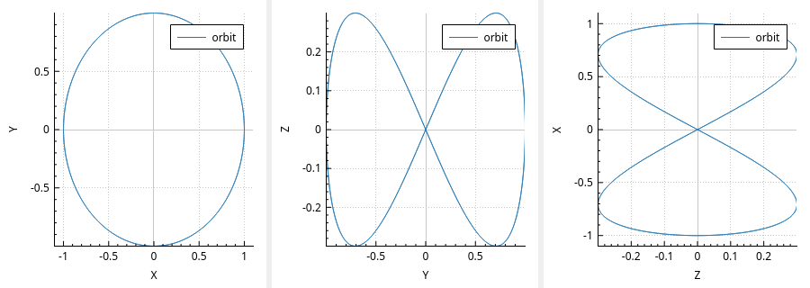

When the time comes first, the curves are coloured by time, and a time marker can follow a cursor on another plot. Pass only the dimensions (`[x, y, z]`) to skip that.

A projection needs at least 2 panes. On a 1-pane projection, `add_reference_curve` raises `ValueError`. A model or callback curve reports each batch through its `fetch_failed` signal instead.

`proj.set_dimension_pairs([(0, 1), (0, 2), (1, 2)])` picks the dimensions each pane shows, as (x, y) indices: here X-Y, X-Z, Y-Z, the usual magnetospheric layout. Call it before adding curves.

`proj.set_axis_linking(...)` sets how the axes follow each other:

- `ProjectionAxisLinking.ByDimension`, the default: axes showing the same dimension move together.
- `ProjectionAxisLinking.Independent`: nothing is linked (`proj.set_linked_axes(False)` does the same).
- `ProjectionAxisLinking.SameScale`: also, every axis has the same span, each around its own centre, and the panes stay square. One data unit is then the same length everywhere, and a circle stays round.

```python
from SciQLopPlots import ProjectionAxisLinking, SciQLopNDProjectionPlot

proj = SciQLopNDProjectionPlot(3)
proj.set_axis_linking(ProjectionAxisLinking.SameScale)
assert proj.equal_aspect_ratio()      # square panes come with the same scale
```

`proj.set_equal_aspect_ratio(True)` keeps the panes square on their own.

In the inspector, a projection plot has a properties panel for these settings, and its panes are listed under it, each with its axes and its own plot properties.

Panes are named after their axis labels ("X-Y"). With long labels, give them short names; they stay when the labels or pairs change:

```python
import numpy as np
from SciQLopPlots import GraphType, SciQLopNDProjectionPlot

proj = SciQLopNDProjectionPlot(3)
proj.set_axis_labels(["X GSM [R_E]", "Y GSM [R_E]", "Z GSM [R_E]"])
proj.set_pane_names(["XY", "YZ", "ZX"])

# One boundary drawn in every pane, shown once in the legend.
proj.set_shared_legend(True)
phi = np.linspace(0, 2 * np.pi, 100)
pieces = [proj.subplot(i).plot(10 * np.cos(phi), 12 * np.sin(phi), labels=["bow shock"],
                               graph_type=GraphType.ParametricCurve)
          for i in range(proj.subplot_count())]
proj.group("bow shock", pieces)
```

A group on a projection plot can hold curves from any pane, or whole trajectories. Grouping one pane's piece of a trajectory raises `ValueError`: group the trajectory instead.

## Signal processing

`SciQLopPlots.dsp` filters, transforms and summarises time series. It works on plain NumPy arrays and needs no plot and no `QApplication`.

It is built for real measurements:

- **Gaps are handled for you.** Data is split where samples are missing, and each piece is processed on its own.
- **It is fast.** The work runs in C++, on several threads, with Python's global lock released. Other Python threads keep running meanwhile.
- **Types are kept.** `float32` data gives `float32` results.

```python
import numpy as np
from SciQLopPlots import dsp

t = np.arange(0, 600, 0.5)                          # seconds, one sample every 0.5 s
b = np.column_stack([np.sin(t / 30), np.cos(t / 30), 0.2 * np.sin(t / 5)])   # 3 components

t_out, magnitude = dsp.reduce(t, b, "norm")         # |B| at each time
assert magnitude.shape == t.shape
```

### Arrays in, arrays out

Every function takes the same two arrays:

- **`x`**: the sample times, a 1-D array of seconds. It is converted to `float64`. It must increase.
- **`y`**: the values. Either 1-D, or 2-D with one row per time and one column per component: shape `(n, k)`, like the `plot()` functions take.

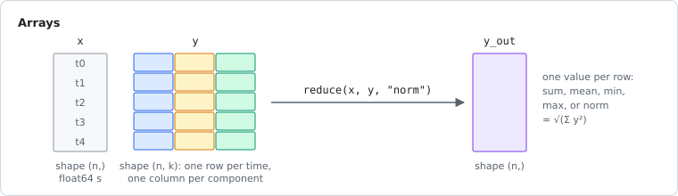

`y` keeps its type when it is `float64`, `float32` or `int32`. Other integer and float types, `int64` included, are computed as `float64`, and the result is `float64`.

`datetime64` times are not converted for you either. Use seconds: `x = times.astype("datetime64[ns]").astype(np.int64) / 1e9`.

Most functions return a new `(x, y)` pair. The spectral ones return one result per segment (see [Spectra](#spectra)).

### Gaps

Instruments miss samples: a telemetry drop, a calibration pause, a data hole. A filter or a rolling window that runs straight across such a hole mixes data from both sides. That gives values that never existed.

So the functions first look for gaps:

1. They take the median time step of `x`.
2. A step longer than `gap_factor` times the median (3 by default) is a gap.
3. The data is split there into segments, and each segment is processed on its own.
4. The results are joined back, with one row of NaN at each gap, stamped at the middle of the gap. A plot breaks its line on a NaN, so the hole stays visible.

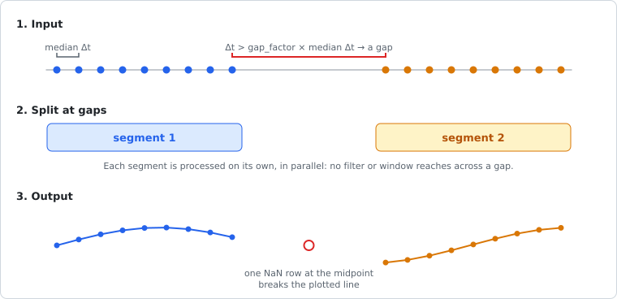

```python
import numpy as np
from SciQLopPlots import dsp

t = np.r_[np.arange(0, 100.0), np.arange(200, 300.0)]   # a 100 s hole in 1 s data
y = np.sin(t / 10)

assert dsp.split_segments(t, y) == [(0, 100), (100, 200)]   # [start, end) row ranges

t_out, smooth = dsp.rolling_mean(t, y, 5)
assert len(t_out) == len(t) + 1                     # one extra row: the NaN at the gap
assert t_out[100] == 149.5 and np.isnan(smooth[100])
```

Two parameters control this:

- **`gap_factor`** (default 3): how many median steps make a gap. Raise it for jittery sampling, lower it to catch shorter holes.
- **`has_gaps=False`**: skip the search and treat the data as one segment. Use it when you know the sampling is regular: it saves time on large arrays, and no NaN row is added.

`int32` values have no NaN. Their gap rows hold 0 instead.

### Filters

Four filters, in two pairs:

| Function | Filter | Phase |
|---|---|---|
| `fir_filter(x, y, coeffs)` | FIR, from its taps | causal: delays the signal |
| `filtfilt(x, y, coeffs)` | FIR, run forward then backward | zero phase: no delay |
| `iir_sos(x, y, sos)` | IIR, as second-order sections | causal: delays the signal |
| `sosfiltfilt(x, y, sos)` | IIR, run forward then backward | zero phase: no delay |

`filtfilt` and `sosfiltfilt` give the same results as `scipy.signal.filtfilt` and `scipy.signal.sosfiltfilt`, edges included. Use them to clean data you then look at. Use the causal pair when the output must only depend on the past, as in a real-time filter.

The coefficients must have the same type as `y`. With `float32` data, pass `coeffs.astype(np.float32)`.

Here a 0.5 Hz wave is buried in noise. A 101-tap low-pass FIR, built with NumPy alone, removes the noise. `fir_filter` lags by half the filter, 50 samples (0.5 s). `filtfilt` does not lag.

```python
import numpy as np
from SciQLopPlots import SciQLopPlot, dsp

fs = 100.0                                          # samples per second
t = np.arange(0, 20, 1 / fs)
rng = np.random.default_rng(0)
raw = np.sin(2 * np.pi * 0.5 * t) + 0.5 * rng.standard_normal(t.size)

taps = 101                                          # windowed-sinc low-pass at 2 Hz
n = np.arange(taps) - (taps - 1) / 2
coeffs = np.sinc(2 * 2.0 / fs * n) * np.hamming(taps)
coeffs /= coeffs.sum()

_, causal = dsp.fir_filter(t, raw, coeffs)
_, zero_phase = dsp.filtfilt(t, raw, coeffs)

plot = SciQLopPlot()
plot.plot(t, raw, labels=["raw"])
plot.plot(t, causal, labels=["fir_filter: delayed"])
plot.plot(t, zero_phase, labels=["filtfilt: aligned"])
plot.x_axis().set_range(2, 8)
plot.y_axis().set_range(-2.5, 2.5)
```

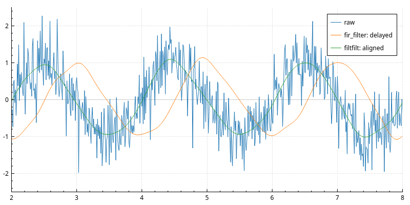

For IIR filters, design the sections with SciPy:

```python
import numpy as np
from scipy import signal
from SciQLopPlots import dsp

t = np.arange(0, 20, 0.01)
raw = np.sin(2 * np.pi * 0.5 * t) + 0.3 * np.sin(2 * np.pi * 20 * t)

sos = signal.butter(4, 2.0, fs=100, output="sos")   # 4th-order low-pass at 2 Hz
_, smooth = dsp.sosfiltfilt(t, raw, sos)
```

`sos` has one row per section, `[b0, b1, b2, a0, a1, a2]`: the format SciPy returns.

### Spectra

`fft` and `spectrogram` turn time into frequency. Frequencies are in hertz when `x` is in seconds: the sampling rate comes from the median time step.

They return a **list, with one result per segment**. A spectrum across a gap would be meaningless, so each segment gets its own.

```python
import numpy as np
from SciQLopPlots import dsp

t = np.arange(0, 10, 0.01)                          # 100 Hz
y = 2 * np.sin(2 * np.pi * 5 * t)                   # amplitude 2, at 5 Hz

[(freqs, magnitude)] = dsp.fft(t, y, window="rectangular")    # one segment, one result
assert np.isclose(freqs[magnitude.argmax()], 5.0)
assert np.isclose(magnitude.max(), 1.0)             # amplitude / 2
```

The magnitude is `|FFT| / N`, one-sided. A sine of amplitude A peaks at A/2 with `window="rectangular"`, and lower with a tapered window: A/4 with `"hann"`, the default. The windows are `"hann"`, `"hamming"`, `"blackman"`, `"flattop"` and `"rectangular"`. For 2-D `y`, `magnitude` has one column per component.

`spectrogram` cuts one column of `y` (`col`, 0 by default) into windows of `window_size` samples. Each window gives one power spectrum, stamped at the time of its centre sample.

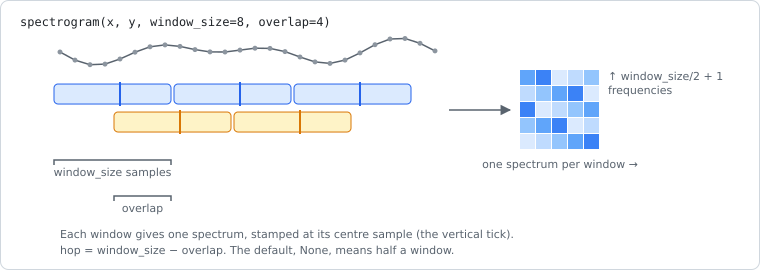

`overlap` is how many samples two neighbouring windows share. 0 means windows that touch without overlapping. The default, `None`, means half a window. The power is `|FFT / N|²`.

Each result is `(t, f, power)`, and `power` has shape `(len(t), len(f))`. That is what a colour map takes, so it plots directly:

```python
import numpy as np
from SciQLopPlots import SciQLopPlot, ColorGradient, dsp

fs = 100.0
t = np.arange(0, 120, 1 / fs)
rng = np.random.default_rng(1)
y = np.sin(2 * np.pi * (1 + 0.15 * t) * t) + 0.3 * rng.standard_normal(t.size)   # rising tone

[(st, f, power)] = dsp.spectrogram(t, y, window_size=256, overlap=192)

plot = SciQLopPlot()
spectrum = plot.plot(st, f, power, name="power")
spectrum.set_gradient(ColorGradient.Viridis)
spectrum.set_z_log_scale(True)
```

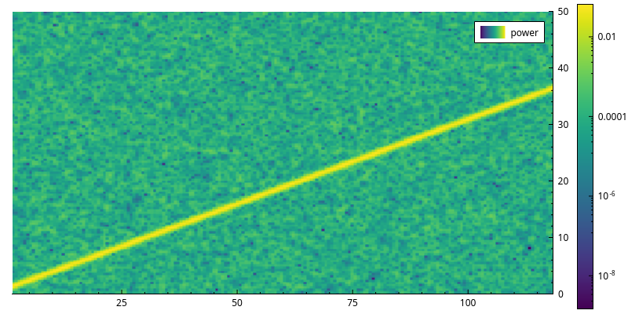

A segment shorter than `window_size` gives empty arrays.

### Rolling statistics

`rolling_mean`, `rolling_std` and `rolling_percentile` slide a window along the time axis. `window` counts **samples**, not seconds: with one sample every 4 s, `window=15` covers one minute.

The window is centred on each sample. It shrinks near the ends of each segment instead of padding, and it never crosses a gap. NaN samples inside it are skipped.

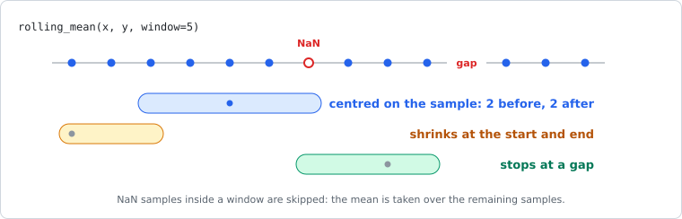

The output has the input's times, plus the gap rows. `rolling_std` is the sample standard deviation (divided by n − 1).

`rolling_percentile` with `q=50`, the rolling median, ignores spikes that drag a mean away:

```python
import numpy as np
from SciQLopPlots import SciQLopPlot, dsp

t = np.arange(0, 600, 1.0)
rng = np.random.default_rng(2)
y = np.sin(t / 60) + 0.1 * rng.standard_normal(t.size)
y[rng.choice(t.size, 25, replace=False)] += 4       # spikes

_, mean = dsp.rolling_mean(t, y, 31)
_, median = dsp.rolling_percentile(t, y, 31, q=50)

plot = SciQLopPlot()
plot.plot(t, y, labels=["data with spikes"])
plot.plot(t, mean, labels=["rolling mean"])
plot.plot(t, median, labels=["rolling median"])
plot.x_axis().set_range(0, 600)
plot.y_axis().set_range(-1.5, 5.5)
```

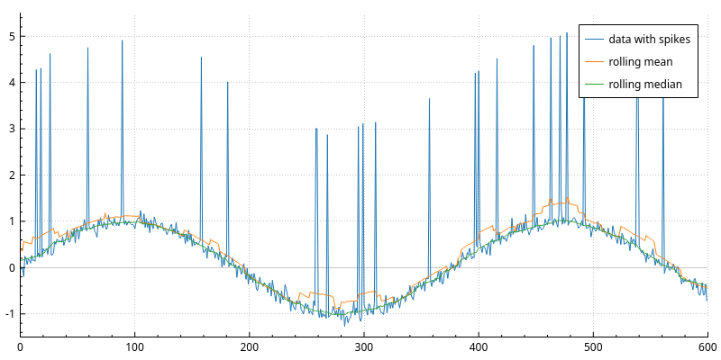

When a window holds only NaN, all three give NaN. `rolling_std` also gives NaN when only one value is left, like `np.nanstd(..., ddof=1)`.

### Reductions

`reduce(x, y, op)` combines the columns of each row into one value. `op` is `"sum"`, `"mean"`, `"min"`, `"max"` or `"norm"` (the square root of the sum of squares). NaN values are skipped. A row of only NaN gives NaN for `"mean"`, `"min"` and `"max"`. It gives 0 for `"sum"` and `"norm"`, like `np.nansum`.

`reduce_axes` does the same for data whose columns hide several dimensions. A particle instrument, for example, may store 32 energies × 16 angles × 8 angles as 4096 columns per time. Give the shape, and the axes to reduce:

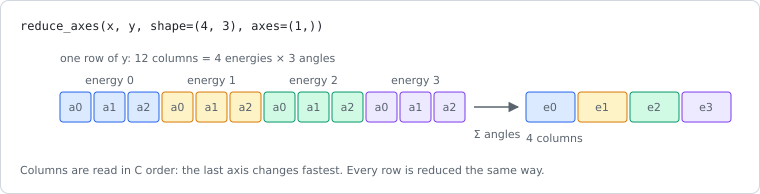

```python
import numpy as np
from SciQLopPlots import dsp

t = np.arange(10.0)
counts = np.ones((10, 32 * 16 * 8), dtype=np.float32)      # energy × theta × phi per row

_, energy_spectrum = dsp.reduce_axes(t, counts, shape=(32, 16, 8), axes=(1, 2), op="sum")
assert energy_spectrum.shape == (10, 32)                   # one column per energy
assert energy_spectrum[0, 0] == 16 * 8
```

Columns are read in C order, NumPy's default: the last axis changes fastest. `reduce_axes` adds no gap rows.

`column_percentile(y, q)` goes the other way: it reduces **time** away and keeps the columns. It is a quick background estimate for a spectrogram:

```python
import numpy as np
from SciQLopPlots import dsp

rng = np.random.default_rng(3)
power = rng.exponential(1.0, size=(500, 64))        # 500 times × 64 frequencies
background = dsp.column_percentile(power, q=10)      # one value per frequency
cleaned = power - background                         # broadcasts over the rows
assert background.shape == (64,)
```

It skips NaN, and matches `np.nanpercentile`.

### Resampling and missing values

`resample(x, y, target_dt=...)` puts each segment on a regular grid, by linear interpolation. The grid starts at the segment's first sample. Without `target_dt`, the step is the median step of `x`.

`interpolate_nan(x, y, max_consecutive=1)` fills short runs of NaN by linear interpolation between their neighbours. Runs longer than `max_consecutive`, and runs at either end, stay NaN.

```python
import numpy as np
from SciQLopPlots import dsp

t = np.array([0.0, 1.0, 2.5, 4.0])
y = np.array([0.0, 1.0, 2.5, 4.0])
t_reg, y_reg = dsp.resample(t, y, target_dt=1.0)
assert list(t_reg) == [0.0, 1.0, 2.0, 3.0, 4.0]

y = np.array([1.0, np.nan, 3.0, np.nan, np.nan, 6.0])
filled = dsp.interpolate_nan(np.arange(6.0), y)                # runs of 1 only
assert np.isnan(filled[3]) and filled[1] == 2.0
```

### Good to know

- **Check names.** An unknown `window` or `op` raises `ValueError` and lists the valid ones.
- **Call it from a thread.** The functions release Python's global lock while they compute, so a worker thread can filter while the interface stays responsive.
- **Mind empty windows.** Over only NaN, sums and norms give 0, like `np.nansum`. Everything else gives NaN. With `int32` data, which has no NaN, those places hold 0.
- **Sort `x`.** The functions don't check that times increase. Unsorted times give wrong results, without an error.

## Export

```python
import numpy as np
from SciQLopPlots import SciQLopPlot

plot = SciQLopPlot()
x = np.linspace(0, 10, 1000)
plot.plot(x, np.sin(x), labels=["sin"])

plot.save_png("figure.png", 1200, 800)   # raster, width and height in pixels
plot.save_pdf("figure.pdf")              # vector, current size
plot.save_svg("figure.svg", 800, 500)    # vector, for the web or to edit
plot.save("figure.svg")                  # the format follows the extension
```

`save_jpg` and `save_bmp` also exist. Panels export all their plots together: `panel.save_pdf("panel.pdf")`.
A save that fails raises `OSError` (a missing folder, say), an unknown extension `ValueError`.

## Threads

Plots live on the GUI thread. You can still call them from another thread:

- **Setters queue themselves.** A setter called from another thread (`set_visible`, `set_title`,
  `set_range`, `add_plot`, ...) runs on the GUI thread a moment later and returns at once.
- **Bad arguments still raise in your thread.** A wrong value, a null object, a component filled
  against itself, an unknown edit mode: the setter checks these before it queues itself.
- **Mistakes that depend on the plot's state only warn.** The count of labels or colours, a column
  past the last, a fill whose component is in another graph, a bin range below zero with log bins:
  these are checked on the GUI thread, after earlier queued calls. From another thread they print
  a warning there and raise nothing.
- **Data setters run in your thread, on purpose.** `set_data`, `set_data_and_color`,
  `set_color_data`, `set_values`, `set_binned`, `set_time_values` and `set_color_values` read the
  arrays you pass while you still hold them, and `data_changed` fires before they return, in the
  order you called them.
- **Factories refuse other threads.** `plot()`, `create_plot()`, item constructors and the like
  hand an object back, so they raise `RuntimeError` off the GUI thread.
- **`set_x_axis` / `set_y_axis` run in the calling thread.** The plot calls them itself while it
  arranges its graphs, on the GUI thread. Call them there too.
- **Protected hooks are for subclasses.** `_visible()`, `_set_color()` and the other `_x` hooks are
  where a subclass plugs in. Called from Python on a library object, they run the base default
  (most raise `NotImplementedError`), not the class's own code. Call the public method instead.
- **Deleting from a slot.** A slot can delete a graph, an item, a span or a timeline from its own
  signal. It must not delete the plot or panel that is emitting from inside its own mouse or
  keyboard event: `shiboken6.delete(plot)` in a selection slot triggered by a click crashes, as Qt
  forbids it. Use `plot.deleteLater()` or the panel's `remove_plot`.

## Performance tips

- **Give it everything.** Millions of points are fine: each graph is downsampled to the screen resolution in a background thread. Don't decimate yourself.
- **No need to convert.** `float32` values, integer values and `(n, k)` row-major arrays (NumPy's default) are read in place.
- **Keep data functions lean.** They hold Python's global lock while they run; slow pure-Python loops there slow down every other fetch. Do the heavy work in NumPy or a C extension, which release the lock.
- **Use a prefetch margin** for raw-data sources ([above](#fetch-a-margin-around-the-view)).
- **Profile with the built-in tracer** when something is slow:

```python
import os, tempfile
import numpy as np
from SciQLopPlots import SciQLopPlot, tracing

trace = os.path.join(tempfile.gettempdir(), "sciqlop-trace.json")
with tracing.session(trace):
    plot = SciQLopPlot()
    x = np.linspace(0, 10, 1_000_000)
    plot.plot(x, np.sin(x), labels=["big"])
# open the JSON file in https://ui.perfetto.dev
```

Or set `SCIQLOP_TRACE=/path/trace.json` in the environment to trace a whole run.

## Troubleshooting

**The window never appears, or Qt aborts at start.** Create the `QApplication` before any plot, and call `app.exec()` (or run inside an application that already has an event loop). On a headless machine, set `QT_QPA_PLATFORM=offscreen` for scripts that only export files.

**`Keys (x) must be float64`.** Convert `x` with `x.astype(np.float64)`. For `datetime64`, see [Time series](#time-series).

**The plot is empty.** Check that the axis range covers your data (`plot.rescale_axes()`). For a data function, check it returns arrays for the ranges it is asked, not `None`.

**A data function's changes don't show.** The same range is not fetched twice. Call `graph.invalidate_cache()` after changing what the function returns.

**`unsupported keyword 'metaData'`.** The keyword is `metadata=` now, like every other snake_case argument.

**`NotImplementedError: <kind> is not supported by <class>`.** That plot class cannot hold this kind of graph. For example, a time-series plot cannot hold a histogram. Use a `SciQLopPlot`, or call `plot()` on a panel, which creates a suitable plot.

**`TypeError` about `plot_type`, or `ValueError` on a panel.** `plot_type` is for panels only. On a panel, a list of arrays always makes a projection, so leave `plot_type` out or pass `PlotType.Projections`.

**A camelCase name works but isn't documented.** It has a snake_case twin, and the camelCase one is deprecated: on panels `set_selected`, `add_widget`, `remove_widget`, `index_of` and the `selection_changed` signal; on spans `selection_changed`; on panel-wide lines and spans `add_object`, `remove_object`. `LineTermination.SPikeArrow` is `SpikeArrow`.

**Something else.** Open an issue at https://github.com/SciQLop/SciQLopPlots/issues with a small script that shows it.
